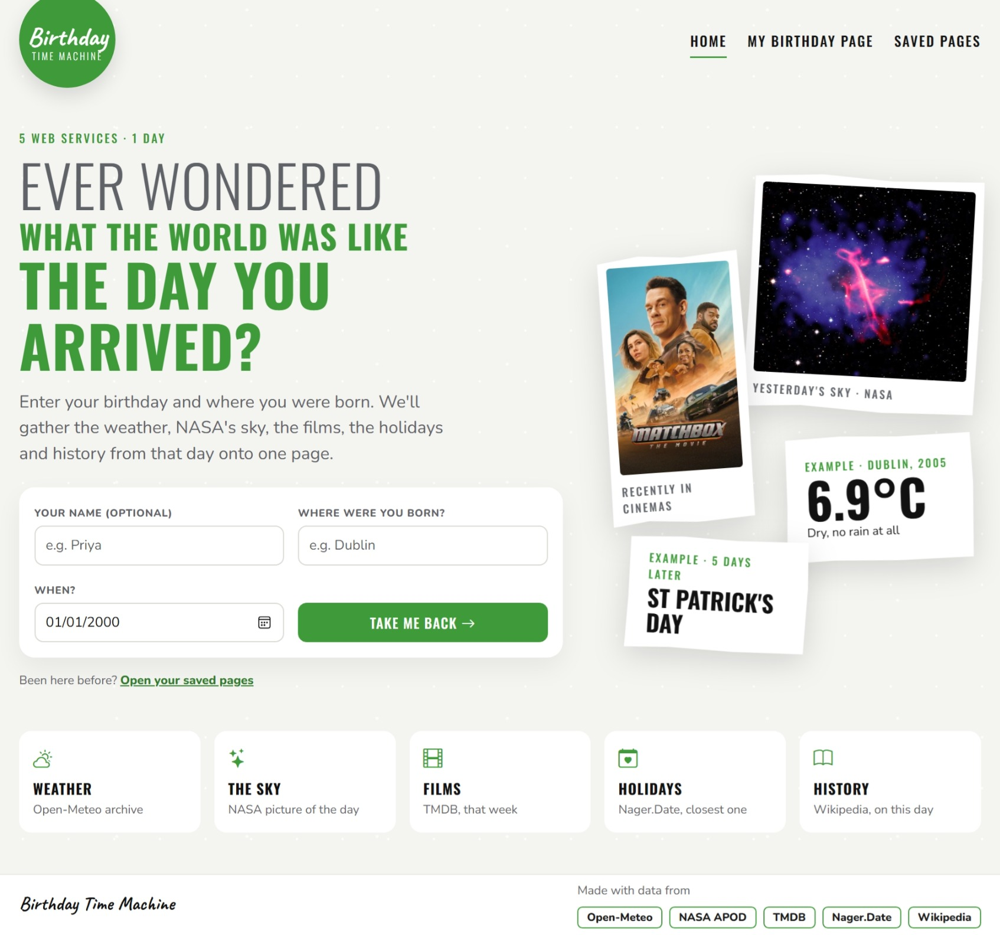
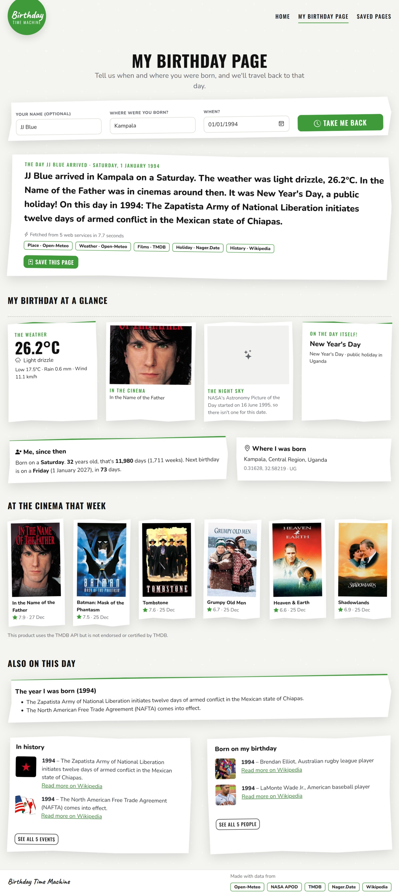
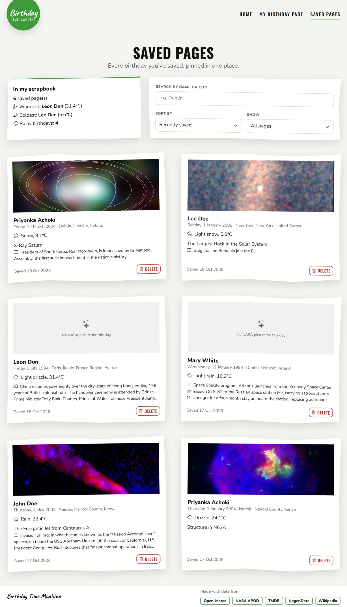

# Birthday Time Machine

**SOA – CA1** · [YOUR NAME] ([STUDENT NUMBER]) · [YOUR GITHUB REPO URL]

For this assignment I wanted to make something a bit more interesting than a standard API demo. Instead of just showing data from one service, I liked the idea of showing what the world was like on the day somebody was born.

The Birthday Time Machine lets you enter your name, the city you were born in and your birthday. The app then combines information from six web services (five different providers) and puts it all on one page. It shows the weather on the day, NASA's picture of the sky, films released around that time, historical events, famous birthdays and the closest public holiday. It also creates a short summary that brings all of the information together into a single sentence about your birthday.



## Features

- Search from the home page with your name (optional), city and date
- A one-sentence "story" of your birthday made from all the APIs
- Weather, a film, NASA's picture and the nearest holiday at a glance
- Your age in years, days and weeks, and a countdown to your next birthday
- NASA's picture with its explanation, films from that week, and history and famous birthdays (with a pop-up to see more)
- Save your birthday pages to a JSON file, then search, sort and filter them




## APIs I used

| API | What it gives me |
|---|---|
| Open-Meteo Geocoding | Turns the city into coordinates and a country code |
| Open-Meteo Historical Weather | The weather on the day |
| Wikipedia "On this day" | Events and famous people born that day |
| NASA Astronomy Picture of the Day | The picture of the sky on your birthday |
| TMDB | Popular films released that week |
| Nager.Date | Public holidays for your country |

The weather and holidays need the city's coordinates and country code, so geocoding has to happen first. Once I have that information, most of the other API calls can run at the same time using Task.WhenAll.

Running the requests in parallel made the page load noticeably faster than calling each service one after another.
## Running it

1. Clone the repo and open `BirthdayTimeMachine.slnx` in Visual Studio (.NET 10).
2. The films need a free TMDB key (https://www.themoviedb.org/settings/api). Right-click the **BirthdayTimeMachine** project → **Manage User Secrets** and add:
```json
   { "Tmdb": { "ApiKey": "your-key-here" } }
```
   I used User Secrets so my key isn't on GitHub. If there's no key, the app still runs – the films section just shows a message.
3. Press **F5** to run it. To run the tests, go to **Test → Run All Tests**.

## How I covered the brief

- **Data types** – I used `DateOnly` for birthdays, nullable types for weather values that can be missing, enums for the sort and filter options, a record for the story parts, and tuples.
- **Collections** – lists everywhere, a dictionary that turns weather codes into text and icons, and LINQ for searching, filtering and finding the warmest and coldest birthdays.
- **Sorting and comparison** – `SavedReport` implements `IComparable` (sorts by birthday), and I wrote two `IComparer` classes to sort by temperature and by name.
- **Interfaces** – every service has its own interface and is added with dependency injection, which also made them easy to test.
- **Web services** – each API has its own service with a typed `HttpClient`. I read the JSON into classes that match the API, then convert it into simpler classes for the app.
- **Error handling** – every section has its own `try/catch`, so if one API is down the rest of the page still works. I check status codes (like 401 for a bad key and 404 for unsupported countries), every API has a timeout, the user gets a friendly message and the real error is logged with `ILogger`.
- **Testing** – I ended up with over 100 xUnit tests. For the services I created a FakeHttpMessageHandler that returns sample JSON so I could test the mapping logic without depending on the real APIs. I also tested error cases, helper classes and saving reports to JSON.
- **No database** – saved pages are stored in `Data/reports.json`.

## Problems and limitations

- The weather history only goes back to **1940**.
- NASA's picture of the day started in **June 1995**. While I was building this, NASA's API started sending back their logo for every date, so I switched to the `science.nasa.gov` feed and added a check for placeholder images. If there's no picture, I link to NASA's page for that day instead.
- I only show films with at least **100 votes** on TMDB, because without it some really obscure (and inappropriate) films came up.
- Nager.Date doesn't have holidays for every country.
- Wikipedia's "on this day" only uses the day and month, so the events are from lots of different years.
- If I had more time, I'd break the birthday page up into smaller components, because it got quite long.

## What I learned

The biggest thing I learned from this project was how to combine data from multiple APIs and handle cases where one service fails without breaking the rest of the page.

I also got a lot more experience working with dependency injection, HttpClient, asynchronous programming and unit testing. Creating a fake HTTP handler for the service tests was particularly useful because it let me test the API logic without making real network requests.

## Branches

I worked on `feature/weather`, `feature/birthday-report` and `feature/ui-polish`, and merged each one into `master` with a pull request.

## References

**APIs**
- Open-Meteo Geocoding – https://open-meteo.com/en/docs/geocoding-api
- Open-Meteo Historical Weather – https://open-meteo.com/en/docs/historical-weather-api
- Wikipedia "On this day" – https://api.wikimedia.org/wiki/Feed_API/Reference/On_this_day
- NASA APOD – https://apod.nasa.gov/apod/
- NASA API logo problem (issue #184) – https://github.com/nasa/apod-api/issues/184
- TMDB – https://developer.themoviedb.org/docs (This product uses the TMDB API but is not endorsed or certified by TMDB.)
- Nager.Date – https://date.nager.at/Api

**.NET**
- Blazor – https://learn.microsoft.com/aspnet/core/blazor/
- HttpClient / IHttpClientFactory – https://learn.microsoft.com/aspnet/core/fundamentals/http-requests
- User Secrets – https://learn.microsoft.com/aspnet/core/security/app-secrets
- Logging – https://learn.microsoft.com/dotnet/core/extensions/logging
- xUnit – https://xunit.net/

**Design**
- Bootstrap 5 – https://getbootstrap.com/
- Bootstrap Icons – https://icons.getbootstrap.com/
- Google Fonts – https://fonts.google.com/
- Scrapbook design inspiration – https://designmodo.com/scrapbook-website-design/
- CSS paper effects – https://freefrontend.com/css-paper-effects/

